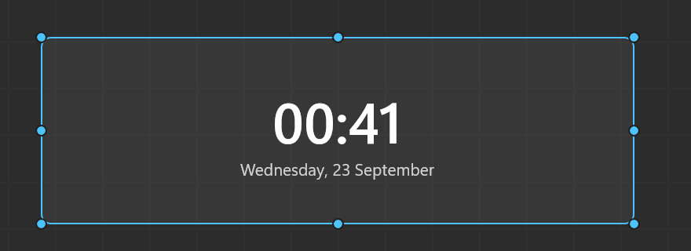

# Themia for WinUI

A minimal native rebuild of [Themia](https://github.com/crazy-rabbit-software/themia) — the desktop
widget app — on **WinUI 3 / .NET 10, compiled ahead of time**. The point of the exercise is the
runtime cost: no web view, no JavaScript engine, no JIT.

It is a vertical slice, not a port of the catalogue: **six widgets** - clock, CPU, memory, disk,
battery and mail - plus all the machinery — edit mode, drag and resize, snapping, the widget picker, per-widget settings, views,
per-display view assignment, copy / cut / paste, dragging a widget onto another display, a tray icon,
and persistence.



## What it costs

Measured on this machine (Windows 11, 3840x2160 at 150%, two displays), one clock widget:

| | |
|---|---|
| Executable | **7.1 MB** single native binary |
| Managed DLLs shipped | **0** — no CoreCLR, no `System.*.dll` |
| Working set | **~90 MB** with one widget, **~141 MB** with six across two displays |
| Idle CPU | **~0.3% of one core** |
| Wakes per minute | **1** (a clock without seconds asks for a 1-minute cadence) |

The working set is dominated by WinUI's own compositor and render thread — a bare WinUI 3 window
with a single `TextBlock` measures ~83 MB here, so the entire app adds ~7 MB on top of the framework
floor. The total on-disk folder is ~123 MB because the Windows App SDK is bundled self-contained;
that is disk, not memory, and it buys not needing the runtime installed.

## Running it

```bash
dotnet build src/Themia.App/Themia.App.csproj -c Release
```

```bash
dotnet test tests/Themia.Core.Tests/Themia.Core.Tests.csproj
```

For the ahead-of-time build (needs the MSVC linker; `scripts/publish.ps1` puts `vswhere` on PATH for
you, which the ILCompiler needs and does not find on its own):

```powershell
powershell -ExecutionPolicy Bypass -File scripts/publish.ps1
```

The app has no main window. It starts in the tray:

- **Double-click the tray icon** (or double-click a widget) to toggle edit mode.
- **Right-click the tray icon** for edit mode, add widget, view switching, settings and exit.
- In edit mode: drag to move, eight handles to resize, **Alt** to bypass snapping, right-click a
  widget to configure, duplicate or delete.
- **Ctrl+C / Ctrl+X / Ctrl+V**, **Delete** and **Escape** work in edit mode. Paste lands at the
  cursor, on whichever display it is over — so copy on one screen and paste on another.
- Dragging a widget onto another display moves it there, when that display shows a different view.

State lives in `%APPDATA%\Themia.WinUI\state.json`; warnings and errors go to `themia.log` beside it.

## How it is put together

```
src/Themia.Core/      pure logic, no UI, no Windows dependency - all of the tests live here
  Geometry/           fractional rects, snapping, clamping, resize
  Model/              AppState / ViewState / WidgetInstance, enums, typed widget config
  Storage/            atomic single-writer persistence + load-time validation
  Time/               shared tick scheduling
  Widgets/            clock formatting
src/Themia.App/       WinUI 3 shell
  Interop/            Win32 (LibraryImport), desktop layering, monitors, tray icon
  Services/           app host, shared ticker, startup registration
  Shell/              widget surface, cards, settings, dialogs
  Widgets/            widget catalogue + the clock view
tests/                xUnit over Themia.Core
```

The split is deliberate: everything with a rule in it lives in `Themia.Core`, which has no UI types,
so the geometry, persistence and scheduling rules are tested without needing a window.

### Widgets

The system meters - CPU, memory, disk, battery - read straight from Win32 rather than through
`PerformanceCounter`, which is not trim-safe and slow to its first value. Each samples at the cadence
its number actually changes at: CPU and memory once a second, disk and battery once a minute.

**Mail comes from [hearth](../hearth-app), and this app contains no provider code at all** - no
account, no token, no Graph, no IMAP, no sync. Hearth owns all of that behind one local pipe with
per-app consent; the widget asks for the `email` scope, lists what it is granted, and re-queries when
the hub pushes a change. The wire types are declared here with a source-generated JSON context rather
than by referencing `Hearth.Client`, because the SDK serialises reflectively and would not survive
AOT (`[S-93]`).

### The three ideas worth knowing

**Geometry is fractional.** A widget stores `x, y, w, h` as fractions of its screen, never pixels
(`[S-01]`/`[S-02]` in [SPEC.md](SPEC.md)). The same layout opens proportionally on any monitor. The
snap grid is an *aid* applied during a drag, never storage.

**One window per display, not one per widget.** All the widgets on a screen share a single
transparent, click-through surface. The window is clipped with `SetWindowRgn` to the union of the
widget rects, so clicks anywhere else land on the desktop underneath. That is what keeps the cost
flat as widgets are added: one HWND, one composition target and one render thread per display, no
matter how many widgets you place.

**It is a desktop layer, always.** The surface is never topmost and never raised — not even in edit
mode. Edit mode has to drop `WS_EX_NOACTIVATE` so keyboard shortcuts work, and an activatable window
gets raised when clicked, so the window procedure is subclassed and every `WM_WINDOWPOSCHANGING` is
rewritten back to "bottom". The trade-off is deliberate: **you can only edit a widget where the
desktop is actually visible.** If another window covers it, it cannot be clicked.

## Deliberate limitations

These are choices or known platform limits, not oversights:

- **Six widget types.** The registry (`WidgetCatalog`) and the persisted discriminator
  (`WidgetKind`) are built for more; adding one is an enum member plus a catalogue entry plus a view.
- **The mail widget is read-only** and needs the hearth hub running. It asks for the `email` scope
  alone, never `email.send`, and shows an empty state naming what is missing when it cannot read.
- **Mixed-DPI multi-monitor is untested.** Placement uses each monitor's physical work area and
  layout uses the window's own rasterization scale, so it should be correct, but this machine runs
  both displays at 150% and I could not exercise the mixed case.
- **No sync, licensing, updater or localization.** Out of scope for a vertical slice.

## Things that only break in the published build

Two failures here were invisible during development and appeared only after `dotnet publish`. Both
are now pinned by a comment at the fix site:

- `dotnet publish` **dropped every compiled XAML file** (`.xbf`). The app started and then threw
  `XamlParseException` at the first `InitializeComponent`. The XAML compiler writes them to the build
  output but never registers them as publish items; the `PublishCompiledXaml` target in the csproj
  does.
- The ILCompiler needs **`vswhere` on PATH** to find the MSVC linker, and does not add it itself.

Two more traps worth recording. `OverlappedPresenter.SetBorderAndTitleBar(false, false)` does **not**
clear `WS_CAPTION` — the surface carried a title bar and a 3px border the whole time, invisible only
because the click-through region happened to clip them away, so the title bar appeared the instant
edit mode dropped the region, and the border meant the mask never quite lined up with the widgets.
The frame is now stripped at the Win32 level. And `SWP_FRAMECHANGED` on an ordinary z-order change
forces a non-client recalculation that hands the frame straight back, so it is passed only on a
genuine style change.

And the DPI trap, which cost the most time: `AppWindow.MoveAndResize`
takes **physical** pixels, but XAML lays out in DIPs, and PowerShell is DPI-virtualized unless you
call `SetProcessDpiAwarenessContext` — so a screenshot-based check of a 3840x2160 display at 150%
silently reports 2560x1440 and every coordinate you compare against is wrong by 1.5x. The same
applies to driving the app with synthetic input while someone is using the machine: the real mouse
wins, and the resulting screenshots look like layout bugs that are not there.
